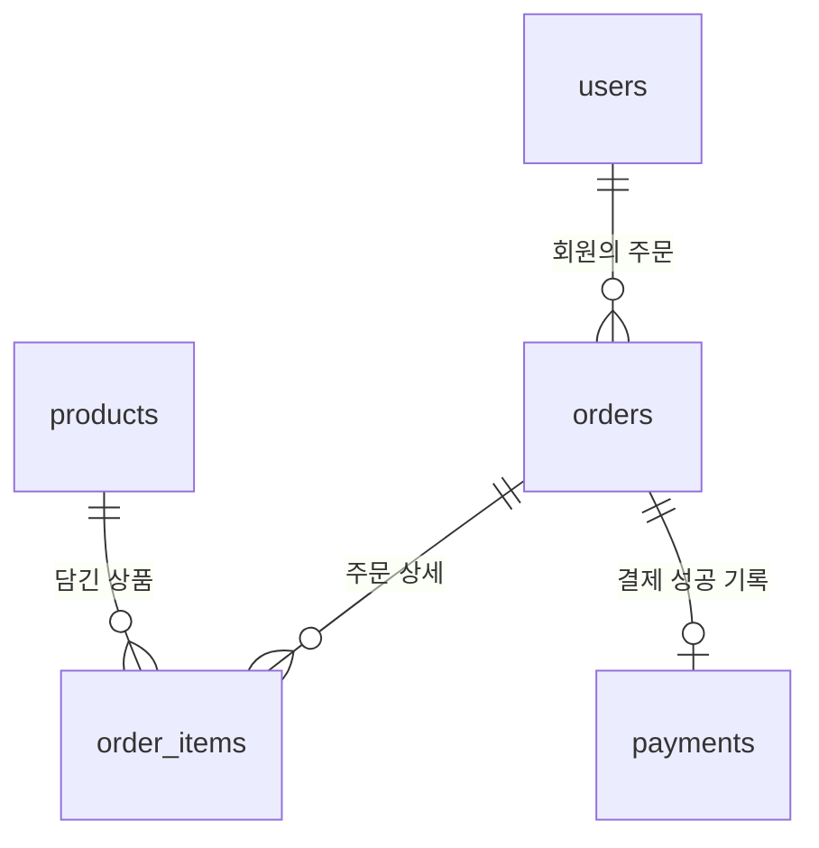

# 간단 쇼핑몰 — 1단계

Python + FastAPI + Supabase + Jinja2로 만드는 학습용 쇼핑몰입니다.
현재는 폴더, 패키지 목록, 설정 예시와 SQL만 준비했습니다.
서버 파일은 2단계에서 만듭니다. 코드 실행과 테스트는 수행하지 않았습니다.

## 폴더 구조

```text
simple_shop/
├── .env.example          # 복사해서 .env로 사용
├── .gitignore            # 비밀키와 가상환경 제외
├── requirements.txt      # 설치할 Python 패키지
├── README.md             # 설치와 DB 준비 안내
├── sql/
│   ├── 01_schema.sql     # 테이블 생성
│   └── 02_seed.sql       # 샘플 상품 4개
└── app/
    ├── __init__.py
    ├── routers/          # 상품·회원·주문 등의 요청 처리
    │   └── __init__.py
    ├── services/         # DB 접근과 처리 로직
    │   └── __init__.py
    ├── templates/        # 다음 단계부터 HTML 저장
    └── static/
        ├── css/          # 모바일 우선 CSS
        └── js/           # 순수 JavaScript
```

`.gitkeep`은 빈 폴더를 Git에 보관하기 위한 빈 파일입니다.
`.venv`와 `.env`는 아래 명령으로 사용자가 직접 만듭니다.

## Windows PowerShell에서 준비

```powershell
cd "C:\강사님_Git\ai4_section01\Day12\simple_shop"
py -m venv .venv
.\.venv\Scripts\Activate.ps1
python -m pip install -r requirements.txt
Copy-Item .env.example .env
python -c "import secrets; print(secrets.token_urlsafe(48))"
```

마지막 명령의 출력값을 `.env`의 `JWT_SECRET_KEY`에 넣습니다.
`py` 명령을 찾을 수 없고 `python`이 설치되어 있다면 첫 명령을
`python -m venv .venv`로 바꿉니다.

가상환경 활성화가 PowerShell 실행 정책 때문에 막히면, 활성화 없이
가상환경의 Python을 직접 사용해도 됩니다.

```powershell
.\.venv\Scripts\python.exe -m pip install -r requirements.txt
```

이후의 `python` 명령도 `.\.venv\Scripts\python.exe`로 바꾸면 됩니다.

## Supabase 준비

1. Supabase에서 새 프로젝트를 만들고 프로젝트 URL과 서버 전용
   `service_role` 키를 확인합니다. `anon` 키를 넣지 않습니다.
2. `.env`의 `SUPABASE_URL`, `SUPABASE_KEY`, `JWT_SECRET_KEY`를 채웁니다.
3. SQL Editor에서 `sql/01_schema.sql` 전체를 붙여넣고 실행합니다.
4. 이어서 `sql/02_seed.sql` 전체를 붙여넣고 실행합니다.
5. Table Editor에서 테이블 5개와 products의 상품 4개를 확인합니다.

SQL 파일은 이 프로젝트의 새 DB에 각각 한 번만 실행합니다.
실제 `.env` 내용과 비밀키는 채팅이나 GitHub에 공유하지 않습니다.
브라우저는 FastAPI에 요청하고, FastAPI만 Supabase에 접속합니다.
공개 DB 접근은 RLS와 권한 회수로 막습니다.

## ERD



| 테이블 | PK | FK | 주요 필드 |
| --- | --- | --- | --- |
| users | id | 없음 | email(유일), password_hash, name |
| products | id | 없음 | name, description, price |
| orders | id | user_id → users.id | status |
| order_items | id | order_id → orders.id, product_id → products.id | quantity, unit_price |
| payments | id | order_id → orders.id(유일) | amount, method, paid_at |

`order_items`를 추가한 이유: 한 주문에 여러 상품이 담길 수 있고,
같은 상품도 여러 주문에 담길 수 있어 주문별 상품·수량·단가를 따로 저장해야 합니다.

장바구니와 결제대기 주문에는 결제 기록이 없습니다.
결제완료 주문에는 정확히 하나의 결제 기록을 만들 예정입니다.
`payments.order_id`의 UNIQUE로 중복 결제를 막고, 6단계에서 DB 함수를 추가해
결제 기록 생성과 주문 상태 변경을 하나의 트랜잭션으로 처리합니다.

주문 상태는 `cart`(장바구니) → `pending`(결제대기) → `paid`(결제완료)입니다.
바로 결제는 별도의 `pending` 주문으로 만들고 기존 장바구니는 보관합니다.
금액과 회원 ID는 서버에서 결정하며, 사용자 입력을 SQL 문자열에 이어 붙이지 않습니다.

회원 탈퇴 시 해당 회원의 주문·주문 상세·모의 결제 기록도 함께 삭제됩니다.
이는 학습용 프로젝트의 탈퇴 동작이며 실제 결제 정보는 저장하지 않습니다.

## 다음 단계의 인증 방식

JWT를 HttpOnly 쿠키에 저장합니다. 서버 세션 저장소 없이 로그인 유효성을
확인할 수 있고, JavaScript가 로그인 토큰을 직접 읽지 못하게 할 수 있습니다.

인증은 공통 `Depends` 함수 하나에서 처리하며 토큰과 회원 존재 여부를 확인합니다.
로그인 복귀용 `next`는 `/`로 시작하는 내부 경로만 허용하고,
`//`, 역슬래시, 제어문자 등을 이용한 외부 주소 우회도 거부합니다.
상태를 바꾸는 요청은 POST로 처리하고 쿠키 설정과 CSRF 방어를 함께 적용할 예정입니다.
현재 단계에는 인증 또는 서버 기능이 구현되어 있지 않습니다.
