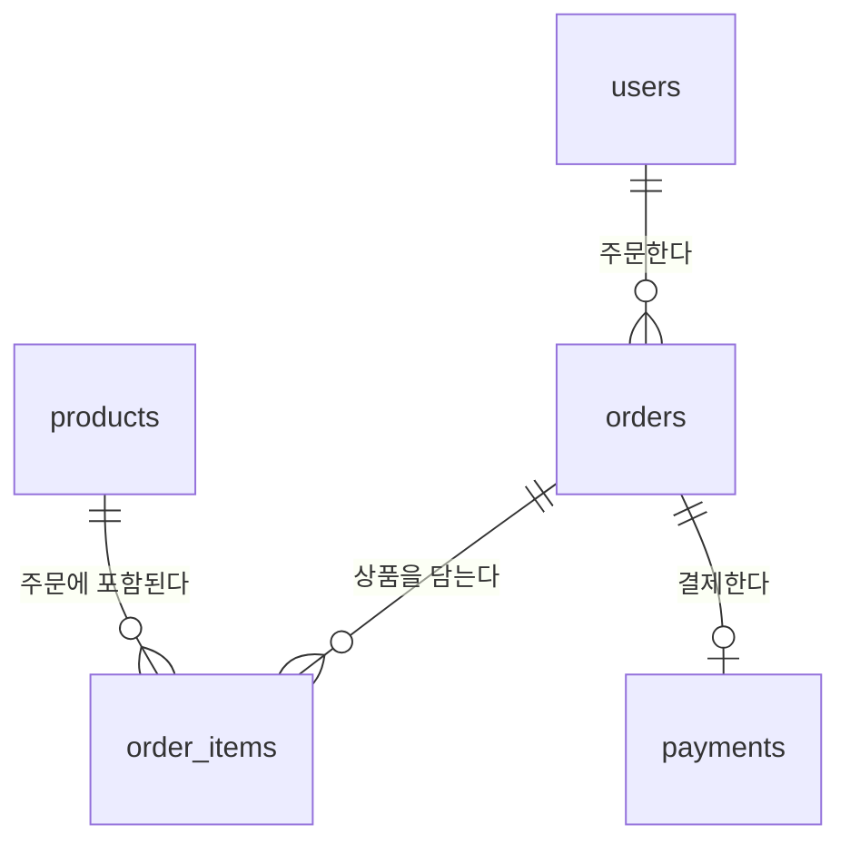
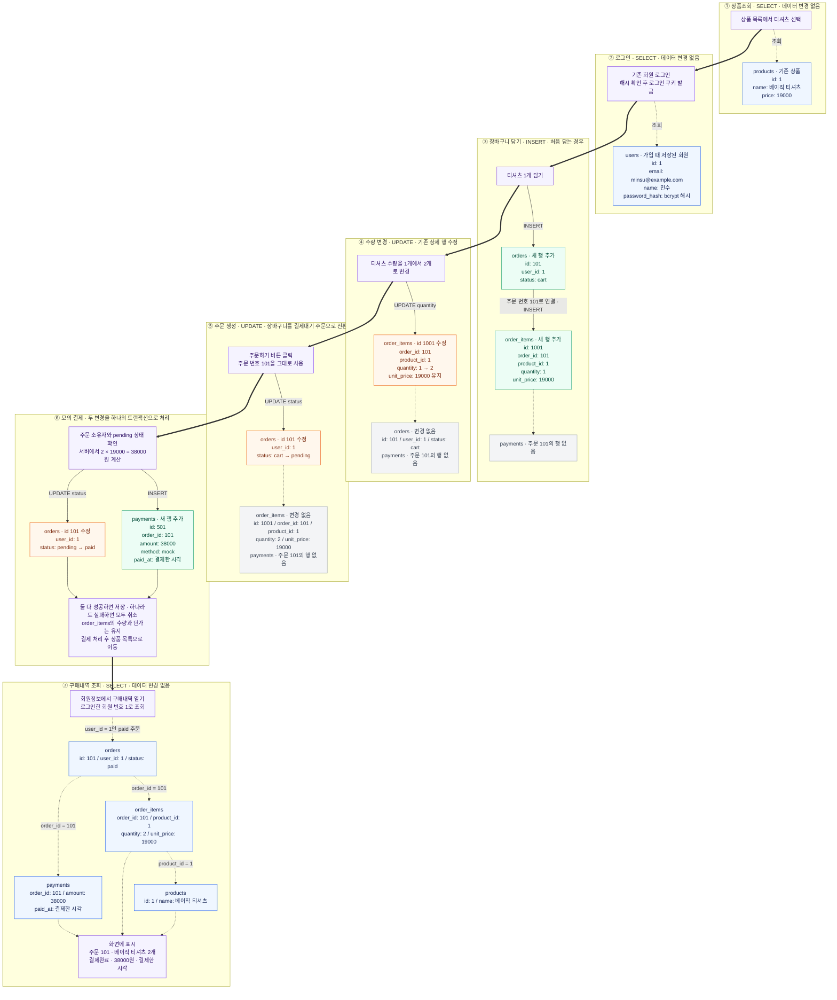

# 간단 쇼핑몰 테이블 정의서

회원이 상품을 골라 장바구니에 담고 모의 결제하는 데 필요한 최소 구조입니다.
기존 `sql/01_schema.sql`을 기준으로 설명합니다. 테이블을 추가하거나 SQL을 변경하지 않습니다.

## 1. 간단 ERD

| 테이블 | 하는 일 |
| --- | --- |
| users | 누가 구매하는가? |
| products | 무엇을 판매하는가? |
| orders | 누구의 주문이고, 현재 어떤 상태인가? |
| order_items | 그 주문에 어떤 상품을 몇 개 담았는가? |
| payments | 그 주문에 얼마를 결제했는가? |

- 회원 한 명은 여러 주문을 가질 수 있습니다.
- 주문 하나에는 여러 상품을 담을 수 있습니다. 상품별 수량과 단가를 저장하기 위해 `order_items`가 필요합니다.
- 주문 하나의 결제 기록은 결제 전에는 0개, 결제완료 후에는 1개입니다.
- 상품 조회만 할 때는 주문이나 결제 기록을 만들지 않습니다.

## 2. 테이블 정의

`PK`는 행을 구별하는 기본키, `FK`는 다른 테이블을 연결하는 외래키입니다.
모든 `id`는 DB가 자동 생성하며, 아래 컬럼은 모두 NULL을 허용하지 않습니다.
`bigint`는 큰 정수, `integer`는 정수, `text`는 문자열,
`timestamptz`는 시간대 정보가 있는 날짜·시간입니다. 금액 단위는 원입니다.

### users — 회원

| 컬럼 | 자료형 | 조건 / 기본값 | 설명 |
| --- | --- | --- | --- |
| id | bigint | PK, 자동 생성 | 회원 번호 |
| email | text | 중복 금지, 소문자, 앞뒤 공백 금지, 빈 값 금지 | 로그인 이메일 |
| password_hash | text | 필수 | bcrypt로 해시한 비밀번호 |
| name | text | 앞뒤 공백을 제외하고 1~50자 | 회원 이름 |
| created_at | timestamptz | 현재 시각 | 가입 시각 |

비밀번호 원문은 저장하지 않습니다. bcrypt 해시는 4단계의 회원가입 코드에서 만듭니다.

### products — 상품

| 컬럼 | 자료형 | 조건 / 기본값 | 설명 |
| --- | --- | --- | --- |
| id | bigint | PK, 자동 생성 | 상품 번호 |
| name | text | 공백만 있는 이름 금지 | 상품 이름 |
| description | text | 빈 문자열 | 상품 설명 |
| price | integer | 0 이상 | 판매 가격 |
| created_at | timestamptz | 현재 시각 | 등록 시각 |

### orders — 주문과 장바구니

| 컬럼 | 자료형 | 조건 / 기본값 | 설명 |
| --- | --- | --- | --- |
| id | bigint | PK, 자동 생성 | 주문 번호 |
| user_id | bigint | FK → users.id | 주문한 회원 |
| status | text | 기본값 cart | cart / pending / paid |
| created_at | timestamptz | 현재 시각 | 주문 생성 시각 |

| 상태 | 의미 | payments 기록 |
| --- | --- | --- |
| cart | 장바구니에 담은 상태 | 없음 |
| pending | 결제를 기다리는 상태 | 없음 |
| paid | 모의 결제를 완료한 상태 | 1개 |

회원 한 명당 `cart` 주문은 최대 하나입니다. `pending`, `paid` 주문은 여러 개일 수 있습니다.

### order_items — 주문 상세

| 컬럼 | 자료형 | 조건 / 기본값 | 설명 |
| --- | --- | --- | --- |
| id | bigint | PK, 자동 생성 | 주문 상세 번호 |
| order_id | bigint | FK → orders.id | 어느 주문에 담겼는지 |
| product_id | bigint | FK → products.id | 어떤 상품인지 |
| quantity | integer | 1 이상 | 구매 수량 |
| unit_price | integer | 0 이상 | 담는 시점의 상품 단가 |

같은 주문에 같은 상품을 중복 행으로 저장하지 않습니다.
`(order_id, product_id)` 조합이 유일해야 하므로, 같은 상품을 다시 담으면 기존 행의 수량을 늘립니다.
`unit_price`는 서버가 `products.price`에서 가져와 저장합니다.
이후 상품 가격이 바뀌어도 기존 주문의 금액은 이 단가로 계산합니다.

### payments — 모의 결제

| 컬럼 | 자료형 | 조건 / 기본값 | 설명 |
| --- | --- | --- | --- |
| id | bigint | PK, 자동 생성 | 결제 번호 |
| order_id | bigint | FK → orders.id, 중복 금지 | 결제한 주문 |
| amount | bigint | 0 이상 | 결제한 총금액 |
| method | text | 기본값 mock, mock만 허용 | 모의 결제 방식 |
| paid_at | timestamptz | 현재 시각 | 결제 완료 시각 |

총금액은 주문 상세의 `quantity × unit_price`를 모두 더한 값입니다.
실제 카드 정보나 계좌 정보는 저장하지 않습니다.

## 3. 상품 구매 시뮬레이션 — MMD

기존 회원이 티셔츠를 1개 담고 2개로 변경한 뒤 결제하는 가상 예시입니다.
DB에 데이터를 넣거나 실행한 결과가 아닙니다. 주요 컬럼만 표시했습니다.

초록은 행 추가, 주황은 값 변경, 파랑은 조회, 회색은 변경 없음을 나타냅니다.
굵은 화살표는 화면 진행 순서이고, 점선은 조회 또는 연결 관계입니다.
현재 설계에서 ‘주문 생성’은 장바구니 주문의 상태를 `cart`에서 `pending`으로 바꾸는 과정입니다.

원본 MMD: [purchase-flow.mmd](purchase-flow.mmd)

## 4. 기억할 규칙

- 회원정보 수정은 `users`의 이름·이메일·비밀번호 해시를 변경합니다.
- 회원 탈퇴 시 해당 회원의 주문, 주문 상세, 모의 결제 기록도 함께 삭제됩니다.
- 주문에 사용된 상품은 외래키 규칙으로 삭제가 제한됩니다. 상품 관리 기능은 구현 범위에 없습니다.
- 기본키·외래키·상태 허용값·중복 금지는 DB에서 제한합니다. 회원별 권한 확인, 비밀번호 해시 생성, 결제 금액 계산과 상태 전환은 이후 서버 및 DB 함수에서 구현합니다.
- 조회는 SELECT, 추가는 INSERT, 수정은 UPDATE, 삭제는 DELETE에 해당합니다. 실제 구현에서는 Supabase 클라이언트로 값을 전달하고 사용자 입력을 SQL 문자열에 이어 붙이지 않습니다.
